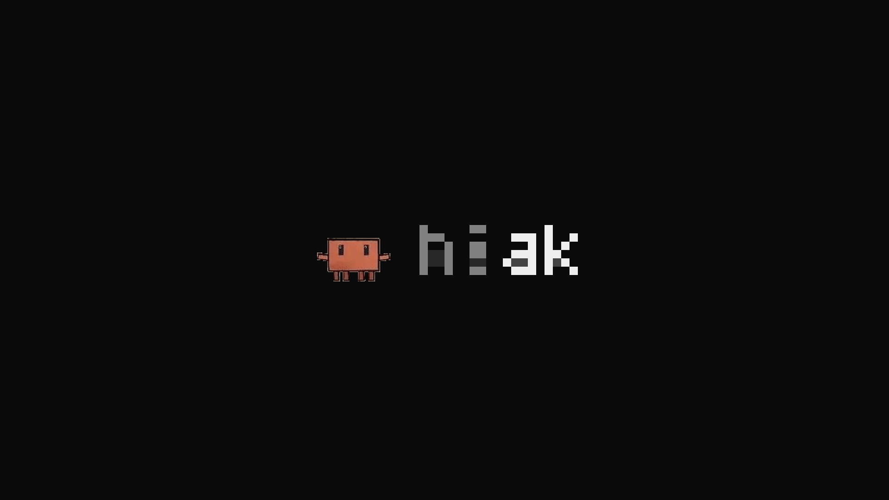

# ⚡ Custom Avatar & Mascot Studio

<p align="center">
  
</p>

<p align="center">
  
  
  
  
  
</p>

---

**Custom Avatar Studio** is an aesthetic desktop identity and character engine built for Windows developers. It unites **OpenCode-style pixel typography** (14px block grid with horizontal inset shadows) with an **expressive animated brick mascot companion** (inspired by Claude Code & retro pixel mascots).

---

## ✨ Features

- **🎮 OpenCode Pixel Typography Engine**: Recreates the exact two-tone `#808080` (gray) + `#EEEEEE` (white) 14px unit-block pixel layout with `#282828` and `#434343` inset shadow bands.
- **🧱 Expressive Mascot Companion**: 7 emotional poses that represent the developer journey:
  1. `1_neutral` – Default focused stance
  2. `2_happy` – Coding joy
  3. `3_wave` – Welcoming you to the terminal
  4. `4_idea` – Lightbulb epiphany
  5. `5_cool` – Sunglasses swagger
  6. `6_coding` – Hacking away on a mini laptop
  7. `7_sleepy` – Late night Zzz
- **🖱️ Interactive Desktop Wallpaper**: Clicking directly on the Windows desktop surface advances the mascot to its next emotional pose in real time (via non-intrusive Windows API polling).
- **💻 Windows Terminal Ubiquity**: Automatically injects animated GIF or high-res widescreen wallpaper backgrounds with tuned opacity (0.35) and bottom-right alignment into Windows Terminal.
- **✨ 24-bit TrueColor Terminal Greeting**: Launches an OpenCode ANSI banner whenever you open PowerShell or CMD across any directory.
- **📱 WhatsApp Direct Clipboard Integration**: 1-click clipboard exporter (`hiak copy`) that formats and puts the animated avatar or DP directly into Windows clipboard for instant pasting (`Ctrl + V`).

---

## 🚀 Quick Start

### Global Command Line (`hiak`)
Since the studio folder is added to your Windows user `PATH`, you can run `hiak` from **any workspace or folder**:

```cmd
# Create an entire studio pack for ANY custom name or friend:
hiak create HARSHA
hiak create ALEX
hiak create DEV

# Switch to that persona across desktop wallpaper & terminal:
hiak switch harsha
hiak switch hiak

# Advance the desktop mascot to the next pose
hiak move

# Print the TrueColor OpenCode pixel logo and banner
hiak banner

# Instantly copy your WhatsApp animated sticker/DP to clipboard (Ctrl+V into chat)
hiak copy

# Check active status and background listener process
hiak status

# Switch between aesthetic visual themes
hiak switch pixel_art
hiak switch cyberpunk_anime
hiak switch lofi_ghibli
hiak switch pixar_3d
hiak switch comic_popart

# Launch the animated fullscreen screensaver
hiak screensaver

# Hide or show desktop icons for unobstructed wallpaper view
hiak icons hide
hiak icons show

# Launch the dark-mode GUI control panel
hiak gui
```

---

## 📁 Repository Structure

```
custom-avatar-studio/
├── hiak.bat                   # Global CLI command for any workspace
├── avatar_studio.bat          # 1-click desktop launcher
├── cli.py                     # Main CLI engine
├── gui.py                     # Tkinter dark-mode control center
├── .gitignore                 # Clean repository filter
├── assets/
│   ├── wallpapers/
│   │   ├── poses/             # 7 sequential 1080p desktop wallpaper frames
│   │   │   ├── 1_neutral.png
│   │   │   ├── 2_happy.png
│   │   │   ├── 3_wave.png
│   │   │   ├── 4_idea.png
│   │   │   ├── 5_cool.png
│   │   │   ├── 6_coding.png
│   │   │   └── 7_sleepy.png
│   │   ├── hiak_moving_mascot.gif      # Terminal animated background
│   │   └── ...
│   ├── whatsapp/
│   │   ├── hiak_moving_avatar.gif      # 600x600 animated avatar
│   │   ├── hiak_opencode_dp.png        # 1024x1024 profile picture
│   │   └── hiak_opencode_chat.png      # 9:16 mobile chat wallpaper
│   ├── banners/
│   │   └── hiak.ans                    # 24-bit ANSI terminal startup banner
│   └── mascots/
│       ├── claude/                     # Reference emotion sheet
│       └── hiak/                       # Custom pixel emotion frames
├── config/
│   ├── current_profile.json   # Active configuration and preferences
│   ├── styles.json            # Available themes & presets
│   └── wallpaper_pose.json    # Active desktop pose state
└── core/
    ├── hiak_logo.py           # Pixel letterform generator & color quantization
    ├── wallpaper_animator.py  # Desktop surface click listener & frame cycler
    ├── wallpaper.py           # Windows SystemParametersInfo API integration
    ├── terminal.py            # Windows Terminal settings.json injector
    ├── banner.py              # PowerShell $PROFILE integration
    ├── whatsapp.py            # Windows clipboard & mobile crop engine
    ├── screensaver.py         # Windows photo screensaver configuration
    └── export.py              # Portfolio HTML card exporter
```

---

## 🔮 Next Roadmap: Multi-User Customization

The next release will feature an automated letterform synthesis engine:
- Generate **any custom word or name** in the 14px OpenCode grid system (A-Z, 0-9)
- Pair with customized mascot companions and color schemes
- Zero-config 1-command setup for friends and teams

---

## 👤 Author
- **Madhav (Hiak-Harsha)**
- GitHub: [@Hiak-Harsha](https://github.com/Hiak-Harsha)
